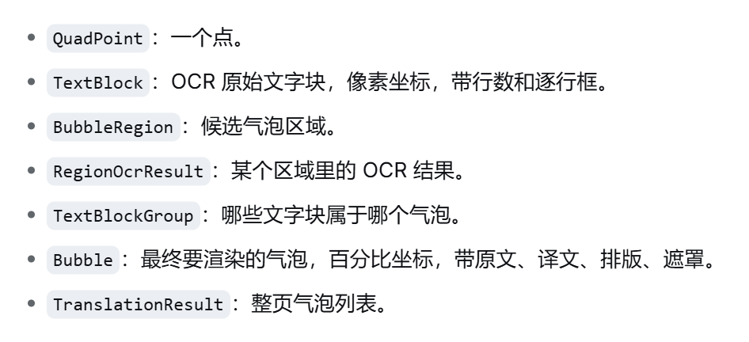

# 项目文件阅读笔记

## 一、UI

### 1. UI颜色、字号、组件样式

* [Color.kt](app/src/main/java/com/manga/translator/app/ui/theme/Color.kt)：定义颜色
* [Theme.kt](app/src/main/java/com/manga/translator/app/ui/theme/Theme.kt)：把 Color.kt 里的颜色、设计稿里的字号和圆角规范，组装成 Jetpack Compose 的 Material 3 主题，并通过 MangaTranslatorTheme 提供给整个 App 使用。
* [MtUi.kt](app/src/main/java/com/manga/translator/app/ui/MtUi.kt)：画图标和定义组件样式。

### 2. 几个界面

* [MainActivity.kt](app/src/main/java/com/manga/translator/app/MainActivity.kt): 应用主入口和主界面容器，负责启动 Compose UI、定义底部导航（首页/浏览器/术语表/翻译历史）、四个主页面切换，以及注册系统能力（录屏授权、通知权限、术语表导入导出、启动/停止截屏服务）。
* [HomeScreen.kt](app/src/main/java/com/manga/translator/app/HomeScreen.kt): 首页（LauncherScreen），负责语言对、OCR 引擎、翻译引擎配置，以及启动/停止截屏服务；同时包含配置档案底部弹层、百度配置弹层、新建/编辑配置表单。
* [GlossaryScreen.kt](app/src/main/java/com/manga/translator/app/GlossaryScreen.kt): 术语表列表页（GlossaryCollectionsScreen）和详情页（GlossaryCollectionScreen），支持新建、导入、导出、复制、合并、重命名、删除、批量删除、生效排序、冲突查看。
* [HistoryScreen.kt](app/src/main/java/com/manga/translator/app/HistoryScreen.kt): 翻译历史列表，每条记录可展开查看气泡原文与译文，支持单条删除、清空全部。
* [EmbeddedBrowserScreen.kt](app/src/main/java/com/manga/translator/app/EmbeddedBrowserScreen.kt): 内嵌浏览器，包含网页浏览、新标签页、历史记录页三个视图，以及连续翻译会话（扫描漫画图 → OCR → 翻译 → 覆盖层贴回）、站点适配、收藏、搜索引擎切换。
* [SwipeRevealRow.kt](app/src/main/java/com/manga/translator/app/SwipeRevealRow.kt): 通用左划删除容器，内容层可水平拖动，右侧露出红色删除按钮，松手按半程吸附；被术语表列表和详情页复用。

## 二、数据模型

### 1.首页看到的

#### （1）源语言与目标语言

* [AppLanguage.kt](core-store/src/main/java/com/manga/translator/store/AppLanguage.kt)：语言枚举，包含英文/日文/韩文/简体中文/繁体中文 5 个值，每个值有 id（存储与对接引擎用）和 label（界面显示用），fromId 做字符串到枚举的转换。

#### （2）OCR配置

* **引擎配置** [OcrEngine.kt](core-store/src/main/java/com/manga/translator/store/OcrEngine.kt)：OCR 引擎枚举，包含 ML Kit 和 PaddleOCR 两个值，id 用于存储与日志，label 用于界面显示
* **速度配置** 只有选Paddle的时候有。（我觉得取消速度配置比较好，我觉得快速模式就够用了，不用选其他的了）[OcrSpeedMode.kt](core-store/src/main/java/com/manga/translator/store/OcrSpeedMode.kt) 枚举类

#### （3）翻译配置

**翻译引擎** [TranslateEngine.kt](core-store/src/main/java/com/manga/translator/store/TranslateEngine.kt) 枚举类。包含以下翻译途径。

* **云端AI api配置档案**: [AiProvider.kt](core-store/src/main/java/com/manga/translator/store/AiProvider.kt)：AI 服务商枚举，带默认 Base URL / Model / 是否支持思考开关，是配置表单的默认值来源。
* **百度配置：** 保存在[AppSettings.kt](core-store/src/main/java/com/manga/translator/store/AppSettings.kt)了
* **ML Kit** 无需配置。

#### （4）首页所有配置的数据载体

* [AppSettings.kt](core-store/src/main/java/com/manga/translator/store/AppSettings.kt)：全量设置数据载体（data class），包含语言对、OCR 引擎、翻译引擎、API Key、百度凭据、思考开关等字段；通过 copy() 局部修改，由 SettingsRepository 持久化。部分字段（ocrMode / ocrProvider / baiduOcrLanguage / ocrBaseUrl / ocrModel / ocrApiKey）是已下线的旧远程 OCR 遗留，实际无人读。
* [SettingsRepository.kt](core-store/src/main/java/com/manga/translator/store/SettingsRepository.kt)：AppSettings 的持久化实现，基于 EncryptedSharedPreferences。负责读写全量设置、配置档案（多套 AppSettings 存为 JSON）、厂商 API Key 记忆、浏览器独立开关、百度 OCR 配额；含旧字段兼容（provider/base_url/model/api_key → translate_*）。

### 2. 浏览器界面

#### （1）选择哪个浏览器

* [BrowserSearchEngine.kt](core-store/src/main/java/com/manga/translator/store/BrowserSearchEngine.kt)：搜索引擎枚举，带搜索 URL 模板与 buildSearchUrl 方法，默认必应。

#### （2）历史记录

#### （3）收藏网址

### 3.术语表

### 4.翻译记录

### 4.识别翻译链路的数据载体

#### （1）点，气泡，文字框等的位置和文字定义类

* [Models.kt](core-translate/src/main/java/com/manga/translator/translate/Models.kt)

#### （2）识别管线

接口：相当于虚继承类。[LocalTextDetector.kt](core-translate/src/main/java/com/manga/translator/translate/LocalTextDetector.kt)

* 类：{**fun1**(图，语言)：return 文字框；**fun2**:模型是否就绪，默认返回true; **fun3**:预加载}
